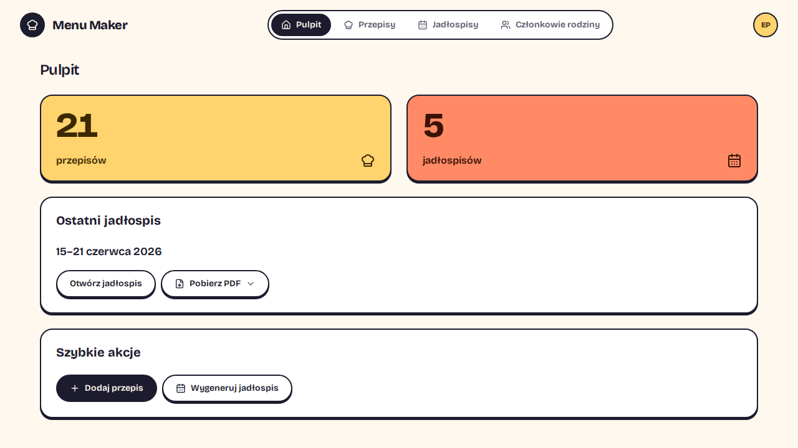
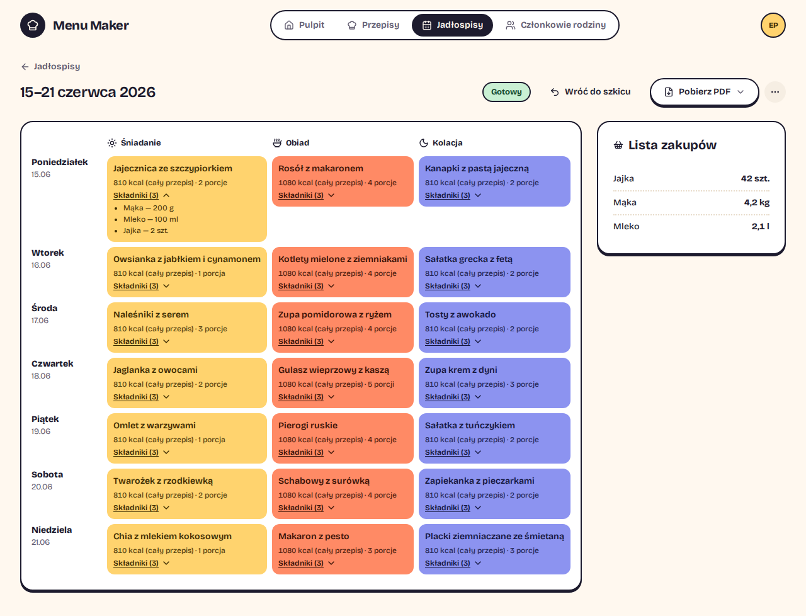

<div align="center">

# Menu Maker

**Plan a family's week of meals from your own recipes, scale the ingredients with AI and print one PDF with the plan and the shopping list.**

[](https://menu.kostecki.dev)
[](../../releases/latest)
[](../../actions/workflows/master.yml)
[](LICENSE)

[](https://www.php.net/)
[](https://laravel.com/)
[](https://inertiajs.com/)
[](https://vuejs.org/)
[](https://tailwindcss.com/)
[](https://www.postgresql.org/)
[](https://playwright.dev/)

[Live app](https://menu.kostecki.dev) · [Changelog](CHANGELOG.md) · [Report a bug](../../issues/new)

**English** · [Polski](README.pl.md)

</div>

<p align="center">
  
</p>

## About

Menu Maker takes the weekly "what do we eat?" off your head. You keep your own recipes and the members of your family; the app draws a week of 7 days × 3 meals, lets you adjust it, scales every ingredient to your family and gives you one PDF with the plan and a consolidated shopping list. The interface is in Polish.

## Features

- **Your recipes** — category, ingredients, preparation, calories and servings, with accent-insensitive search and a Markdown import.
- **Your family** — name, birth date, gender, weight and height; quantities are scaled to these people.
- **Draft week** — 7 days × 3 meals drawn from your recipes without repeats, redrawn as often as you like. Swap a recipe, leave a meal empty, cook a dinner once for two days or turn supper leftovers into the next day's breakfast.
- **AI-refined scaling** — after approval a queue job scales every ingredient in code, then refines the quantities with AI (OpenRouter or the Anthropic API). If the AI call fails you still get the computed quantities.
- **Shopping list** — summed quantities, g → kg and ml → l above 1000, rounded to two decimals.
- **One PDF** — the plan, the shopping list and, optionally, full recipe pages.

<p align="center">
  
</p>

<sub>Screenshots are the approved baselines of the visual test suite, rendered with seeded sample data.</sub>

## Tech stack

| Layer | Technology |
| --- | --- |
| Backend | PHP 8.5, Laravel 13, Inertia.js 3 (Laravel adapter), database queue |
| Frontend | Vue 3, Vite 8, Tailwind CSS 4 (CSS-first), shadcn-vue (reka-ui) |
| Database | PostgreSQL 18 (`unaccent` for accent-insensitive search) |
| AI | OpenRouter or Anthropic API, selected with `AI_SCALING_DRIVER` (`fake` for local work and CI) |
| PDF and backups | DomPDF, `spatie/laravel-backup` |
| Quality | Pest 5, Larastan (level 5), Laravel Pint, Playwright E2E and a visual gate |
| Infrastructure | Laravel Sail locally; Docker Compose, nginx, PHP-FPM and Traefik on a VPS |

## Getting started

### Prerequisites

- Docker and Docker Compose
- Node.js 22+ and npm on the host (Playwright runs from the host)
- Composer for the first `composer install`; every later `php`, `composer` and `artisan` command runs through Sail (PHP 8.5 in Docker)

### Installation

```bash
git clone https://github.com/sebastian-kostecki/menu-maker.git
cd menu-maker

cp .env.example .env              # without AI keys set AI_SCALING_DRIVER=fake
composer install                  # needs PHP 8.5, or add --ignore-platform-reqs

./vendor/bin/sail up -d           # app, queue worker, PostgreSQL and Mailpit
./vendor/bin/sail artisan key:generate
./vendor/bin/sail artisan migrate --seed   # creates test@example.com / password

./vendor/bin/sail npm ci
./vendor/bin/sail npm run dev
```

The app runs on <http://localhost> (or `APP_PORT`), Mailpit on <http://localhost:8025>.

Import Markdown recipes onto an account:

```bash
./vendor/bin/sail artisan recipes:import <dir> --user=<id|email> --dry-run
```

## Development

| Command | What it does |
| --- | --- |
| `sail composer test` | Pest suite |
| `sail composer phpstan` | Larastan static analysis |
| `sail composer pint-test` | Code style check (`composer pint` fixes it) |
| `sail npm run build` | Client and SSR bundles |
| `sail npm run lint:tokens` | Rejects palette classes, hex colours and `dark:` outside `Components/ui/` |
| `npm run test:e2e` | Playwright E2E (Chromium and Firefox) |
| `npm run test:visual` | Visual gate in the pinned Playwright Docker image |

**E2E** run from the host against Sail. `.env` needs `AI_SCALING_DRIVER=fake` and Mailpit as the mailer:

```bash
./vendor/bin/sail npm run build
./vendor/bin/sail artisan db:seed --class=E2eMealPlanSeeder   # re-run before every E2E run
E2E_SKIP_WEBSERVER=1 E2E_BASE_URL=http://localhost npm run test:e2e
```

**Visual gate** — after `npm run build`, with `npm run dev` stopped and the E2E seeder run, `npm run test:visual` compares screenshots with the approved baselines. Update them only on purpose (`npm run test:visual -- --update-snapshots`) and review every changed PNG.

CI ([`master.yml`](.github/workflows/master.yml)) runs all of the above on pull requests into `main`, plus a smoke test of the production image. Day-to-day work happens on `develop`; `main` is the release branch. Commits follow [Conventional Commits](https://www.conventionalcommits.org/).

## Deployment

Production runs on a VPS behind Traefik with `docker-compose.prod.yml` and `Dockerfile.prod`: nginx and PHP-FPM, the queue worker and the scheduler under supervisord, PostgreSQL 18 and encrypted nightly database backups. Copy `.env.prod.example` to `.env.prod`, fill it in and run `scripts/deploy.sh`; it backs up the database, migrates inside a maintenance window and restarts the workers.

## Project scope

**Included:** e-mail authentication with a 24-hour session · family members · recipe CRUD with search and Markdown import · weekly plan drawn without repeats · editable draft · AI-refined scaling with a fallback · consolidated shopping list · one PDF export.

**Out of scope:** importing recipes from URLs · images or videos · sharing recipes between users · dark mode.

## Documentation

- [`CHANGELOG.md`](CHANGELOG.md) — released versions
- [`context/foundation/roadmap.md`](context/foundation/roadmap.md) — milestones
- [`context/foundation/design-system.md`](context/foundation/design-system.md) — design tokens and components
- [`.ai/core/prd.md`](.ai/core/prd.md) — product requirements and user stories
- [`CLAUDE.md`](CLAUDE.md) — rules for coding agents and contributors

## Project status

Version **1.1.0** is released and runs in production at [menu.kostecki.dev](https://menu.kostecki.dev).

## License

Released under the [MIT License](LICENSE).
