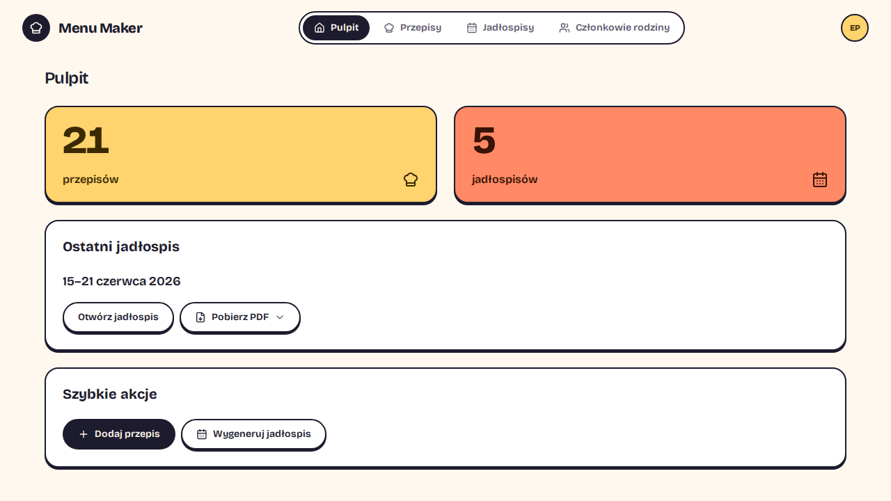
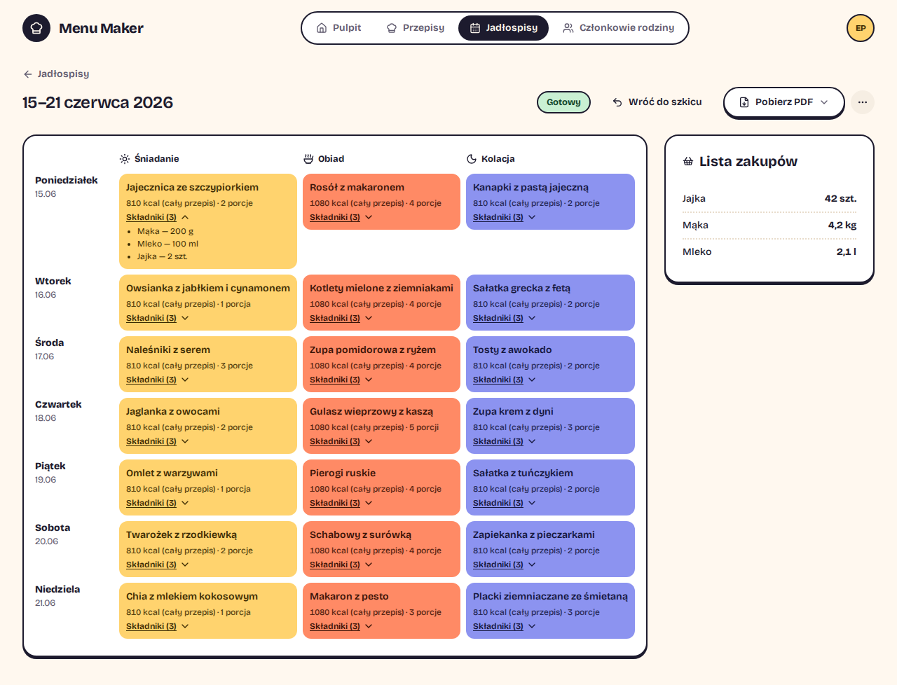

<div align="center">

# Menu Maker

**Zaplanuj rodzinie tydzień posiłków z własnych przepisów, przelicz składniki z pomocą AI i wydrukuj jeden PDF z jadłospisem i listą zakupów.**

[](https://menu.kostecki.dev)
[](https://github.com/sebastian-kostecki/menu-maker/releases/latest)
[](https://github.com/sebastian-kostecki/menu-maker/actions/workflows/master.yml)
[](LICENSE)

[](https://www.php.net/)
[](https://laravel.com/)
[](https://inertiajs.com/)
[](https://vuejs.org/)
[](https://tailwindcss.com/)
[](https://www.postgresql.org/)
[](https://playwright.dev/)

[Aplikacja](https://menu.kostecki.dev) · [Changelog](CHANGELOG.md) · [Zgłoś błąd](https://github.com/sebastian-kostecki/menu-maker/issues/new)

[English](README.md) · **Polski**

</div>

<p align="center">
  
</p>

## O projekcie

Menu Maker zdejmuje z głowy cotygodniowe „co jemy?”. Trzymasz w nim własne przepisy i członków rodziny. Aplikacja losuje tydzień 7 dni × 3 posiłki, pozwala go poprawić, przelicza każdy składnik na Twoją rodzinę i daje jeden PDF z jadłospisem i zbiorczą listą zakupów. Interfejs jest po polsku.

## Funkcje

- **Własne przepisy** — kategoria, składniki, przygotowanie, kalorie i porcje; wyszukiwanie bez względu na polskie znaki i import z Markdownu.
- **Twoja rodzina** — imię, data urodzenia, płeć, waga i wzrost; ilości liczone są dla tych osób.
- **Szkic tygodnia** — 7 dni × 3 posiłki z Twoich przepisów bez powtórzeń, losowane dowolnie wiele razy. Podmień przepis, zostaw posiłek pusty, ugotuj obiad raz na dwa dni albo zamień resztki z kolacji w śniadanie na następny dzień.
- **Przeliczanie z AI** — po zatwierdzeniu zadanie w kolejce przelicza składniki w kodzie, a potem doprecyzowuje ilości przez AI (OpenRouter albo API Anthropic). Gdy wywołanie AI się nie uda, dostajesz ilości policzone w kodzie.
- **Lista zakupów** — zsumowane ilości, g → kg i ml → l powyżej 1000, zaokrąglone do dwóch miejsc.
- **Jeden PDF** — jadłospis, lista zakupów i opcjonalnie pełne przepisy.

<p align="center">
  
</p>

<sub>Zrzuty to zatwierdzone wzorce testów wizualnych, wyrenderowane na przykładowych danych z seedera.</sub>

## Stos technologiczny

| Warstwa | Technologia |
| --- | --- |
| Backend | PHP 8.5, Laravel 13, Inertia.js 3 (adapter Laravel), kolejka w bazie danych |
| Frontend | Vue 3, Vite 8, Tailwind CSS 4 (CSS-first), shadcn-vue (reka-ui) |
| Baza danych | PostgreSQL 18 (`unaccent` do wyszukiwania bez polskich znaków) |
| AI | OpenRouter albo API Anthropic, wybierane przez `AI_SCALING_DRIVER` (`fake` lokalnie i w CI) |
| PDF i kopie | DomPDF, `spatie/laravel-backup` |
| Jakość | Pest 5, Larastan (poziom 5), Laravel Pint, testy E2E Playwright i bramka wizualna |
| Infrastruktura | Laravel Sail lokalnie; Docker Compose, nginx, PHP-FPM i Traefik na VPS |

## Uruchomienie

### Wymagania

- Docker i Docker Compose
- Node.js 22+ i npm na hoście (Playwright działa z hosta)
- Composer do pierwszego `composer install`; każde kolejne polecenie `php`, `composer` i `artisan` idzie przez Sail (PHP 8.5 w Dockerze)

### Instalacja

```bash
git clone https://github.com/sebastian-kostecki/menu-maker.git
cd menu-maker

cp .env.example .env              # bez kluczy AI ustaw AI_SCALING_DRIVER=fake
composer install                  # wymaga PHP 8.5 albo dodaj --ignore-platform-reqs

./vendor/bin/sail up -d           # aplikacja, worker kolejki, PostgreSQL i Mailpit
./vendor/bin/sail artisan key:generate
./vendor/bin/sail artisan migrate --seed   # tworzy test@example.com / password

./vendor/bin/sail npm ci
./vendor/bin/sail npm run dev
```

Aplikacja działa pod <http://localhost> (albo `APP_PORT`), Mailpit pod <http://localhost:8025>.

Import przepisów z Markdownu na konto:

```bash
./vendor/bin/sail artisan recipes:import <katalog> --user=<id|email> --dry-run
```

## Praca nad kodem

| Polecenie | Co robi |
| --- | --- |
| `sail composer test` | Testy Pest |
| `sail composer phpstan` | Analiza statyczna Larastan |
| `sail composer pint-test` | Sprawdzenie stylu (`composer pint` poprawia) |
| `sail npm run build` | Paczki klienta i SSR |
| `sail npm run lint:tokens` | Odrzuca klasy palety, kolory hex i `dark:` poza `Components/ui/` |
| `npm run test:e2e` | Testy E2E Playwright (Chromium i Firefox) |
| `npm run test:visual` | Bramka wizualna w przypiętym obrazie Dockera z Playwright |

**E2E** uruchamiasz z hosta na stosie Sail. `.env` potrzebuje `AI_SCALING_DRIVER=fake` i Mailpit jako serwera poczty:

```bash
./vendor/bin/sail npm run build
./vendor/bin/sail artisan db:seed --class=E2eMealPlanSeeder   # przed każdym przebiegiem E2E
E2E_SKIP_WEBSERVER=1 E2E_BASE_URL=http://localhost npm run test:e2e
```

**Bramka wizualna** — po `npm run build`, przy zatrzymanym `npm run dev` i po seederze E2E, `npm run test:visual` porównuje zrzuty z zatwierdzonymi wzorcami. Wzorce aktualizuj tylko świadomie (`npm run test:visual -- --update-snapshots`) i przejrzyj każdy zmieniony PNG.

CI ([`master.yml`](.github/workflows/master.yml)) uruchamia to wszystko na pull requestach do `main`, plus test dymny obrazu produkcyjnego. Bieżąca praca toczy się na `develop`, `main` to gałąź wydań. Commity są w formacie [Conventional Commits](https://www.conventionalcommits.org/).

## Wdrożenie

Produkcja działa na VPS za Traefikiem z `docker-compose.prod.yml` i `Dockerfile.prod`: nginx i PHP-FPM, worker kolejki i harmonogram pod supervisordem, PostgreSQL 18 i szyfrowane nocne kopie bazy. Skopiuj `.env.prod.example` do `.env.prod`, uzupełnij i uruchom `scripts/deploy.sh`; skrypt robi kopię bazy, migruje w trybie serwisowym i restartuje workery.

## Serwer MCP

Klient MCP, na przykład Claude, może dodawać przepisy na Twoje konto przez jedno narzędzie `add-recipe-tool`. To klient czyta przepis z wklejonego tekstu albo ze strony i pokazuje go Tobie; sama aplikacja nie wywołuje AI i nie pobiera adresów.

**Lokalnie (Claude Code, stdio).** Ustaw w `.env` `MCP_LOCAL_USER` na e-mail albo id konta, na które mają trafiać przepisy. Lokalny serwer startuje tylko przy `APP_ENV=local` i wymaga działających kontenerów Sail. W katalogu projektu:

```bash
claude mcp add menu-maker --scope local -- vendor/bin/sail artisan mcp:start menu-maker
```

**Zdalnie (claude.ai, OAuth).** W claude.ai otwórz Ustawienia → Konektory → Dodaj własny konektor, wpisz `https://menu.kostecki.dev/mcp`, zaloguj się do Menu Makera i zezwól na dostęp. Serwer wymaga kluczy Passport (zobacz `.env.prod.example`).

**Zasady narzędzia.** Klient ma pokazać podgląd i poprosić o zgodę przed zapisem. `calories` to kcal całego przepisu (co najmniej 50), nie porcji. Jednostki składników to tylko `g`, `kg`, `ml`, `l` i `szt`, każdy składnik występuje raz, a pozostałe limity są takie jak w formularzu. Nazwa, którą już masz (bez względu na wielkość liter i spacje), jest odrzucana z linkiem do istniejącego przepisu i nic się nie zapisuje. Zdalny serwer przyjmuje 60 żądań na minutę od użytkownika.

## Zakres

**W zakresie:** logowanie e-mailem z sesją 24 h · członkowie rodziny · przepisy z wyszukiwaniem i importem z Markdownu · tydzień losowany bez powtórzeń · edytowalny szkic · przeliczanie z AI z ilościami zapasowymi · zbiorcza lista zakupów · jeden eksport do PDF.

**Poza zakresem:** import przepisów z adresów URL w interfejsie aplikacji (klient MCP może taki przepis dodać, zobacz [Serwer MCP](#serwer-mcp)) · zdjęcia i filmy · udostępnianie przepisów innym · tryb ciemny.

## Dokumentacja

- [`CHANGELOG.md`](CHANGELOG.md) — wydane wersje
- [`context/foundation/roadmap.md`](context/foundation/roadmap.md) — kamienie milowe
- [`context/foundation/design-system.md`](context/foundation/design-system.md) — tokeny i komponenty
- [`.ai/core/prd.md`](.ai/core/prd.md) — wymagania produktu i historie użytkownika
- [`CLAUDE.md`](CLAUDE.md) — zasady dla agentów i współtwórców

## Status projektu

Wersja **1.1.0** jest wydana i działa na produkcji pod [menu.kostecki.dev](https://menu.kostecki.dev).

## Licencja

Projekt jest udostępniony na [licencji MIT](LICENSE).
